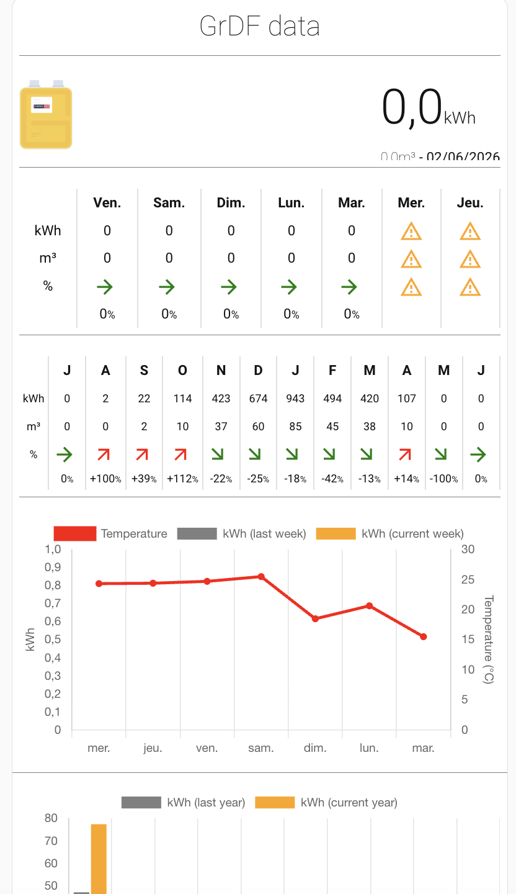

# Mise à Jour de l'Historique Gazpar — Script pyscript pour Home Assistant

Ce script pyscript corrige le décalage de date introduit par l'intégration **Gazpar2MQTT** : GrDF publie les relevés de consommation avec **2 à 5 jours de retard**, ce qui fait apparaître les données dans le panneau Énergie de HA à la mauvaise date. Le script réinjecte l'historique en associant chaque relevé à sa **date réelle de consommation** (et non à sa date de publication).

---

## Dépendances : les intégrations sources

### Gazpar2MQTT (Add-on Home Assistant)

[Gazpar2MQTT](https://github.com/ssenart/gazpar2mqtt) est une passerelle qui interroge le site GrDF et publie les données du compteur Gazpar sur un broker MQTT. Home Assistant les reçoit via l'intégration MQTT et crée automatiquement les entités nécessaires (dont `sensor.<device>_card` utilisée par ce script).

**Installation en tant qu'Add-on HA :**

1. Dans HA → **Paramètres → Modules complémentaires → Boutique des modules** → menu ⋮ → **Dépôts**
2. Ajoutez `https://github.com/ssenart/gazpar2mqtt` puis cliquez **Ajouter**
3. Installez le module **Gazpar2MQTT** qui apparaît dans la boutique
4. Configurez vos identifiants GrDF et le broker MQTT dans les options du module
5. Démarrez le module

Ou cliquez directement :

[](https://my.home-assistant.io/redirect/supervisor_add_addon_repository/?repository_url=https%3A%2F%2Fgithub.com%2Fssenart%2Fgazpar2mqtt)

Une fois démarré, Gazpar2MQTT crée dans HA les entités suivantes (préfixe = nom du device dans la config) :
- `sensor.<device>_card` — données brutes compatibles Lovelace Gazpar Card (**c'est cette entité qu'utilise le script**)
- `sensor.<device>_energy` — énergie totale en kWh
- `sensor.<device>_volume` — volume total en m³

---

### GrDF Gazpar Card (HACS — Dashboard)

[lovelace-gazpar-card](https://github.com/ssenart/lovelace-gazpar-card) est une carte Lovelace qui affiche l'historique de consommation Gazpar sous forme de tableaux et graphiques. Elle est compatible avec Gazpar2MQTT à partir de la version `1.3.11-alpha.3`.

[](https://github.com/ssenart/lovelace-gazpar-card)

**Installation via HACS :**

1. Dans HACS → menu ⋮ → **Dépôts personnalisés**
2. Ajoutez `https://github.com/ssenart/lovelace-gazpar-card` avec la catégorie **Dashboard**, puis cliquez **Ajouter**
3. Le dépôt apparaît dans la liste → cliquez dessus puis **Télécharger**
4. Rechargez le navigateur
5. Dans votre tableau de bord, ajoutez une carte de type `custom:gazpar-card` et sélectionnez `sensor.<device>_card` comme entité

---

## Prérequis : pyscript

[pyscript](https://github.com/custom-components/pyscript) est une intégration custom pour Home Assistant qui permet d'exécuter des scripts Python complets, avec accès aux services HA et à des bibliothèques Python tierces comme `requests`.

### Installation via HACS

1. Dans HACS → **Intégrations** → `+` → cherchez **pyscript**
2. Installez, puis redémarrez Home Assistant
3. Ajoutez dans `configuration.yaml` :

```yaml
pyscript:
  allow_all_imports: true
```

4. Redémarrez à nouveau Home Assistant.

---

## Installation du script dans **pyscript**

### 1. Emplacement du fichier

Déposez le fichier dans le dossier pyscript de votre configuration Home Assistant :

```
config/pyscript/gazpar_energy.py
```

### 2. Adapter la configuration

En tête du script, ajustez les constantes selon votre installation :

```python
SOURCE_SENSOR = "sensor.gazpar_cheptainville_card"   # entité _card créée par Gazpar2MQTT
TARGET_ID     = "sensor.gazpar_cheptainville_energie" # ID de la statistique injectée dans HA
SENSOR_NAME   = "GAZPAR Cheptainville Énergie"        # nom affiché dans le panneau Énergie
UNIT          = "m³"
UPDATE_DAYS   = 7   # fenêtre de réimport incrémental
```

### 3. Prise en compte du script par **pyscript**

Deux options :

**Option A — Redémarrer Home Assistant**

**Option B — Recharger uniquement pyscript** (recommandé) en créant ce script dans vos automatisations HA :

```yaml
alias: Reload pyscript
description: |-
  **Statut :** Finalisé
  **Evolution :** Aucune
  **Rôle :** Recharge l'intégration pyscript sans redémarrer HA.
  **Fonctionnement :**
  1. Appelle `pyscript.reload` pour recharger tous les scripts Python.
sequence:
  - action: pyscript.reload
    metadata: {}
    data: {}
mode: restart
```

---

## Utilisation

### Premier lancement : import complet de l'historique

À faire **une seule fois** pour peupler le panneau Énergie avec tout l'historique disponible (jusqu'à 3 ans) :

**Paramètres → Outils développeur → Services**, appelez :

```
Service : pyscript.gazpar_import_all
```

Ce service fusionne toutes les sources disponibles (`daily`, `weekly`, `monthly`, `yearly`) et injecte les statistiques dans `TARGET_ID`.

### Mises à jour automatiques quotidiennes

L'automatisation **`GAZPAR – Mise à jour statistiques journalières.yaml`** (fournie dans ce dépôt) se déclenche automatiquement à chaque changement de `sensor.<device>_card`, c'est-à-dire dès que Gazpar2MQTT publie de nouvelles données. Elle appelle le service `pyscript.gazpar_update`, qui réimporte les `UPDATE_DAYS` derniers jours avec les données corrigées.

**Importez cette automatisation dans HA :**

1. Copiez le contenu de `GAZPAR – Mise à jour statistiques journalières.yaml`
2. Dans HA → **Paramètres → Automatisations** → menu ⋮ → **Importer**
3. Collez le YAML et sauvegardez

---

## Fichiers

- [`gazpar_energy.py`](gazpar_energy.py) — le script pyscript à déposer dans `config/pyscript/`
- [`GAZPAR – Mise à jour statistiques journalières.yaml`](<GAZPAR – Mise à jour statistiques journalières.yaml>) — l'automatisation HA qui déclenche le script

---

## 📄 Licence

Cette configuration est partagée sous licence MIT. Libre à vous de l'adapter à votre installation.
